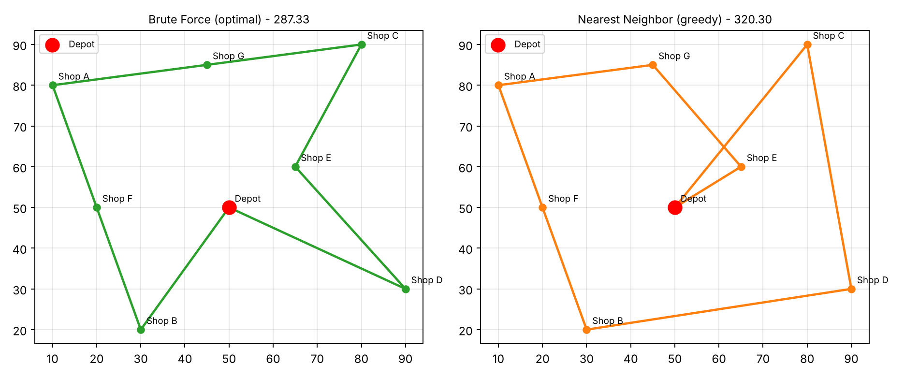
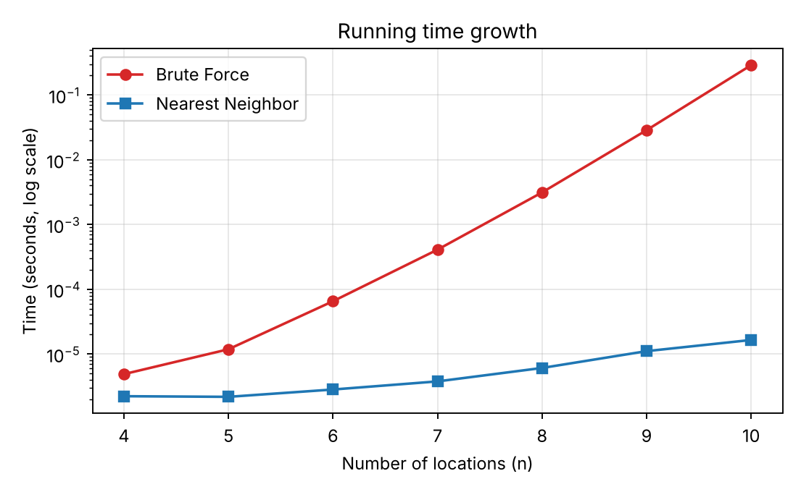

# Delivery Route Planner (TSP): Brute Force vs Nearest Neighbor

A Python project from my Design and Analysis of Algorithms (DAA) course.
It finds a short delivery route that starts at a depot, visits every stop once and returns to the depot (the Travelling Salesman Problem), using two different algorithm design techniques and comparing them.

## Algorithms

| Algorithm | Idea | Time | Space | Optimal? |
|---|---|---|---|---|
| Brute Force (Exhaustive Search) | Try all (n-1)! routes, keep the shortest | O((n-1)! * n) = O(n!) | O(n) | Yes |
| Nearest Neighbor (Greedy) | Always go to the closest unvisited stop | O(n^2) | O(n) | No |

The start city is fixed because a route is a closed loop, which reduces n! routes to (n-1)!.

## Results

**Sample input (8 locations):**

| Algorithm | Distance | Notes |
|---|---|---|
| Brute Force | 287.33 | 5,040 routes checked |
| Nearest Neighbor | 320.30 | 11.48% longer than optimal |



**Over 200 random instances (n = 8):** Nearest Neighbor was on average 8.8% longer than optimal, exactly optimal in 39 cases, and 32.4% longer in the worst case.

**Running time:** at n = 10, Brute Force takes about 0.27 s and Nearest Neighbor about 14 microseconds. Brute force becomes impractical after roughly 11 locations.



(Timings come from my machine and will differ on yours; the growth pattern will not.)

## How to run

```bash
pip install matplotlib      # optional, only needed for the route graph
python route_planner.py
```

Menu options: sample data, random locations, your own locations, or a timing comparison of both algorithms.
Brute force is skipped automatically above 11 locations.

## Project structure

```
route_planner.py     # all code: algorithms, comparison, console menu
images/              # result figures used in this README
```

## Limitations and future work

- Distances are straight-line (Euclidean), not real road distances.
- Brute force only works for small inputs (about 11 locations).
- Nearest Neighbor depends on the starting city; it could be improved with 2-opt or by trying every start city.
- Next step: the Held-Karp dynamic programming algorithm, O(n^2 * 2^n), which solves exact TSP for roughly 20 locations.

## What I learned

How a problem with a simple definition can explode in cost (n!), why a greedy heuristic trades accuracy for speed, and how to back up complexity analysis with measurements.
